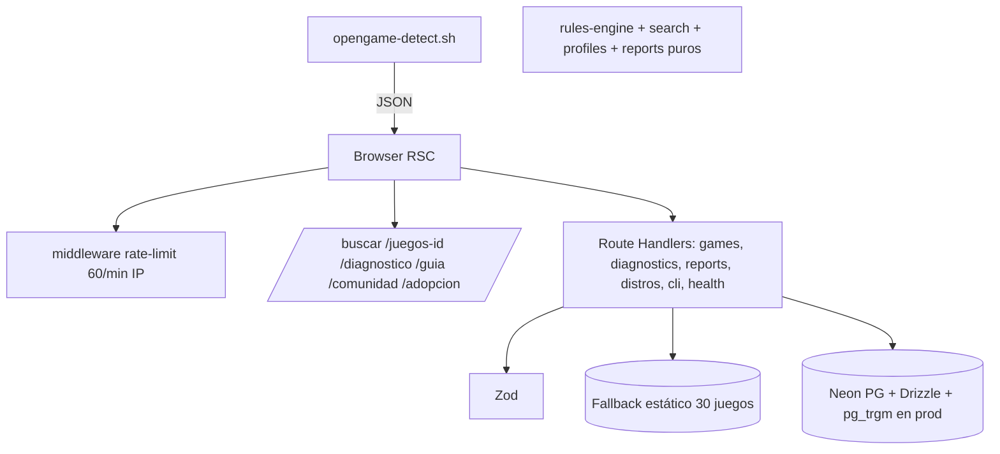

# Arquitectura OpenGame Linux (MVP $0)

Decisiones sustentación:
- RSC + ISR (3600 catálogo, 86400 distros) → mínimo JS, Hobby OK.
- pg_trgm `games_nombre_trgm_idx` en prod; fallback ranking local para demo/tests.
- Route Handlers por dominio → trazabilidad RF 1:1.
- Rate-limit memoria MVP, tabla `rate_limits` en prod (sin Upstash).
- Auth.js stub Fase 0, `x-role: moderator` demo; prod `users.role`.
- Sin scraping: seed propio + Steam API pública.
